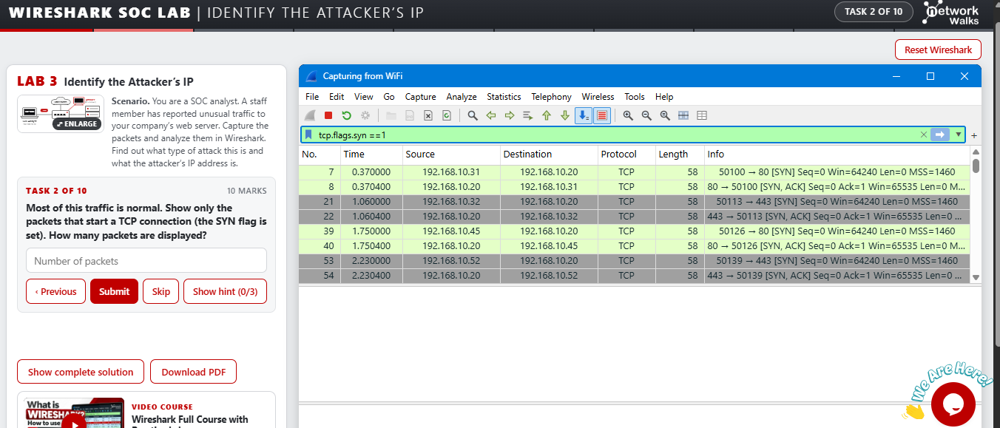

# Wireshark SOC Investigation Labs

A beginner's learning project documenting what I learned while working through six guided Wireshark SOC labs from NetworkWalks.

I created this repository to keep track of the Wireshark features, display filters, and investigation steps I practised. Rather than sharing result-card screenshots, I have documented how I approached each type of traffic and what I learned from the investigation.

## Labs covered

| Lab | Topic | Main skills practised |
|---|---|---|
| 3 | Identify the Attacker's IP | Filtering TCP SYN packets, identifying source and destination hosts, recognizing a port scan |
| 4 | Follow TCP Stream | Finding an unusual TCP conversation and reading a plain-text chat |
| 5 | Follow TCP Stream – Part 2 | Inspecting HTTP streams, finding HTML comments, and examining downloaded text |
| 6 | HTTP Plain-Text Credentials | Filtering HTTP POST requests and understanding why HTTP exposes form data |
| 7 | Brute-Force Detection | Inspecting FTP login attempts, response codes, and repeated authentication failures |
| 8 | VoIP Call Replay | Understanding SIP and RTP, locating a VoIP call, and examining why voice traffic needs encryption |

## Wireshark analysis example

The screenshot below shows the Lab 3 capture with the display filter `tcp.flags.syn == 1` applied. The packet list is narrowed to TCP packets with the SYN flag set, making it easier to inspect connection attempts and compare source and destination addresses.

## What is in this repository?

- [`LEARNINGS.md`](LEARNINGS.md) – investigation steps, Wireshark display filters, packet-analysis explanations, and findings from each lab.
- `wireshark-syn-filter-analysis.png` – a screenshot of the Wireshark interface during the Lab 3 investigation.
- `README.md` – project overview and setup context.

## Tools and environment

- **Wireshark** – packet capture inspection and protocol analysis
- **NetworkWalks Wireshark SOC labs** – guided practice scenarios
- **Windows 11 lab environment** – used to generate and inspect the lab traffic

## How I approached the labs

1. Read the scenario and identify what I need to investigate.
2. Start the capture on the active network interface.
3. Use a display filter to reduce unrelated traffic.
4. Check the Source, Destination, Protocol, Length, and Info columns.
5. Open packet details when I need fields that are not visible in the packet list.
6. Use **Statistics → Conversations**, **Statistics → Protocol Hierarchy**, or **Follow → TCP Stream** when the question requires a broader view.
7. Base the conclusion on the packets and fields I can actually observe.

## Practice sources

- [NetworkWalks Wireshark labs](https://networkwalks.com/wireshark/)
- [Lab 3 – Identify the Attacker's IP](https://networkwalks.com/wireshark-lab3/)
- [Lab 4 – Follow TCP Stream](https://networkwalks.com/wireshark-lab4/)
- [Lab 5 – Follow TCP Stream, Part 2](https://networkwalks.com/wireshark-lab5/)
- [Lab 6 – HTTP Plain-Text Credentials](https://networkwalks.com/wireshark-lab6/)
- [Lab 7 – Brute-Force Catch](https://networkwalks.com/wireshark-lab7/)
- [Lab 8 – VoIP Call Replay](https://networkwalks.com/wireshark-lab8/)

## Note on sensitive data

Some training scenarios intentionally contain sample passwords, temporary credentials, access codes, and payment-card details to demonstrate the risks of unencrypted traffic. I have not copied those values into this repository. The notes focus on the investigation process and security lessons instead.

## Disclaimer

These are personal learning notes from guided practice labs. They are not production incident reports, and the sample IP addresses and events belong to the lab environment. Only capture or inspect traffic on systems and networks you own or have permission to test.
